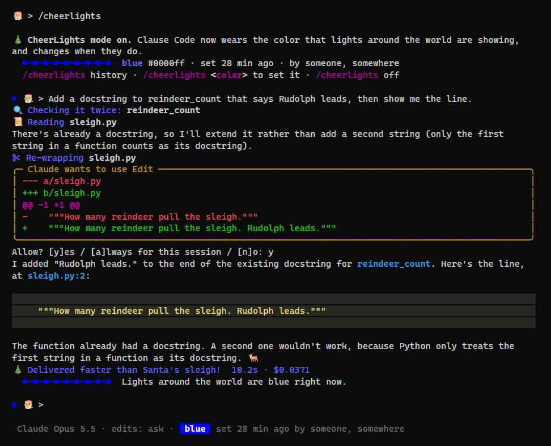

# Clause Code

A holiday-themed coding agent for your terminal, built on the Claude Agent SDK, that can wear the color of CheerLights lights around the world.



[](https://www.python.org/downloads/)
[](https://github.com/nothans/clause-code/blob/main/LICENSE)

Clause Code runs Claude in a project folder.
Claude reads, searches, edits, and runs code there, and you approve each change before it happens.
It wraps the work in Santa or Grinch theming, can follow the live [CheerLights](https://cheerlights.com) color, and ships with an `/advent` calendar for December.

## Quick start

You need Python 3.10 or newer, [uv](https://docs.astral.sh/uv/), and an [Anthropic API key](https://console.anthropic.com/account/keys).
The Claude Code runtime ships inside the `claude-agent-sdk` wheel, so there is nothing else to install.

```bash
git clone https://github.com/nothans/clause-code.git
cd clause-code
uv sync
uv run clause-code
```

The first run asks for your API key (skipped when `ANTHROPIC_API_KEY` is set) and whether you want festive mode.
Clause Code works in the folder you start it from; `--project PATH` picks another one.

```bash
uv run clause-code --project ~/code/sleigh   # work in another folder
uv run clause-code --model haiku             # use a cheaper model for this session
uv run clause-code --continue                # pick up the last conversation in this folder
```

## Example

An excerpt from a run on 2026-11-24 (Clause Code 3.0.0, Claude Haiku 5.5) in CheerLights mode; some lines, including the file-write approval panel, are left out:

```text
● 🎅 > What color are the CheerLights right now, and who set it? One short sentence.
🧰 Unpacking get_color
🎄 Checking the lights
The CheerLights are blue (#0000ff), set 11 minutes ago, and the setter isn't public. 💙
🌟 Guided by the North Star to the answer!  2.3s · $0.0017
  ●─●─●─●─●─●─●─●─●  Lights around the world are blue right now.
● 🎅 > /plan
🗺️ Plan mode on.
● 🎅 > Create hello.txt containing the single line: ho ho ho. Keep the plan to two short lines.
🗺️ Sketching the plan create-hello-txt-containing-the-vectorized-bee.md
🗺️ Handing over the plan
╭─ Claude's plan ──────────────────────────────────────────────────────────────────────────────────╮
│ Create hello.txt in the sleigh-shop project root containing the single line "ho ho ho". Verify   │
│ by reading the file back and confirming it holds exactly that line.                              │
╰──────────────────────────────────────────────────────────────────────────────────────────────────╯
Start building? [y]es / [a]uto-accept edits / [n]o, keep planning: y
🎁 Wrapping up hello.txt
Allow? [y]es / [a]lways for this session / [n]o: y
🎅 Perfect! Added to the nice list!  9.5s · $0.0043
● 🎅 > /undo
⏪ Files are back to how they were before your last message.
Shell command effects are not undone. Claude is told on your next message.
```

The status line under the prompt shows the model, the permission mode, and the live color with when it was set.

## Features

- You approve every file edit and every shell command that changes something, with a diff or command preview first.
- File writes outside the project folder are blocked by a hook that fails closed, even with `/autoaccept` on.
- `/plan` has Claude read and propose a plan; nothing changes until you approve it.
- `/undo` restores the files Claude edited in its last turn, and again for the turn before.
- `/check` sends a reviewer subagent, which did not write the code and cannot edit files, to check the session's changes and answer NICE, NAUGHTY, or UNSURE.
- `--continue`, `--resume`, and `/resume` pick up earlier conversations in the same folder.
- `/cheerlights` themes the prompt, spinner, and status line in the live CheerLights color, says who set it when that is public, and gives Claude tools to read the color and its history.
- Ctrl+C stops Claude's turn and keeps the conversation, on Windows as well as macOS and Linux.

## Limits

- `/undo` restores files that Claude changed with its edit tools; it does not undo shell commands.
- Shell commands that the Claude Code runtime classifies as read-only, such as `git status` or `Get-ChildItem`, run without asking.
- Who set a CheerLights color is known only for colors set from Bluesky; Discord and the other channels do not publish it.
- Setting the CheerLights color needs a Bluesky account and posts publicly from it.
- Claude's tone follows `/santa` and `/grinch` from the next `/clear`; the status messages change at once.
- Tested on Windows 11 and Ubuntu (WSL) with Python 3.12; not tested on macOS.

## Documentation

- [Commands](https://github.com/nothans/clause-code/blob/main/docs/commands.md): every slash command, command-line flag, and keyboard shortcut.
- [CheerLights mode](https://github.com/nothans/clause-code/blob/main/docs/cheerlights.md): what it shows, where the color comes from, and how to set it.
- [Configuration](https://github.com/nothans/clause-code/blob/main/docs/configuration.md): `config.json`, environment variables, and where the API key is kept.
- [How it works](https://github.com/nothans/clause-code/blob/main/docs/how-it-works.md): approvals, the write guard, undo, plan mode, background tasks, and the SDK features behind them.
- [Troubleshooting](https://github.com/nothans/clause-code/blob/main/docs/troubleshooting.md): authentication, a missing runtime, and Ctrl+C.
- [What's new in 3.0](https://github.com/nothans/clause-code/blob/main/docs/whats-new-3.0.md): the changes since 2.0.
- [Introducing Clause Code](https://nothans.com/introducing-clause-code): the blog post that started it.

## Development

```bash
uv sync --extra dev
uv run pytest
uv run ruff check src tests
```

The tests replace the SDK client with `create_autospec(ClaudeSDKClient)`, so a call that does not match the real SDK fails, and they make no network calls.
`CLAUSE_LIVE=1 uv run pytest tests/test_live.py` checks the CheerLights code against the real ThingSpeak, MQTT, and Bluesky services; nothing is posted.

## License

MIT. See [LICENSE](https://github.com/nothans/clause-code/blob/main/LICENSE).
Created by [Hans Scharler](https://nothans.com).
