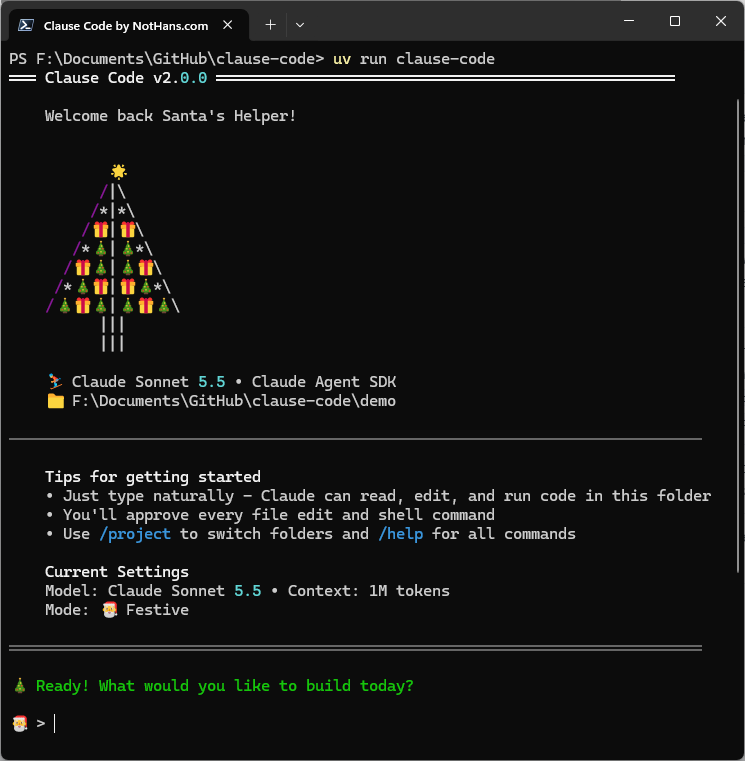

<div align="center">

# 🎄 Clause Code

**A festive AI coding assistant that brings holiday cheer to your terminal**

[](https://www.python.org/downloads/)
[](https://opensource.org/licenses/MIT)
[](https://code.claude.com/docs/en/agent-sdk)
[](https://github.com/astral-sh/ruff)

</div>

---

## 🎁 What is Clause Code?

Clause Code is an interactive terminal coding agent built on the [Claude Agent SDK](https://code.claude.com/docs/en/agent-sdk). Claude can read your project, edit files, and run commands, and you approve every edit and shell command. All of it comes wrapped in holiday theming.

**Key Features:**
- 🛠️ A real coding agent: Claude reads, searches, edits, and runs code in your project folder
- 🔐 You approve every file edit and shell command, with a diff or command preview first
- 🧱 File writes outside the project folder are always blocked
- 💬 Claude Opus 5.5 by default, with Sonnet 5.5 and Haiku 5.5 a `/model` away
- 🎨 Streaming Markdown output with syntax highlighting and festive status messages
- ⏸️ Ctrl+C interrupts Claude mid-turn without quitting
- 📚 Command history with auto-completion
- 🎅 Daily December coding challenges (advent calendar)

## 📸 Screenshot

<div align="center">



*Clause Code's festive terminal interface*

</div>

## 🚀 Quick Start

### Prerequisites

- Python 3.10 or higher
- An [Anthropic API key](https://console.anthropic.com/account/keys)

The Claude Agent SDK ships with its own Claude Code runtime, so there is nothing else to install.

### Installation

#### Option 1: Using uv (Recommended)

```bash
git clone https://github.com/nothans/clause-code.git
cd clause-code
uv sync
uv run clause-code
```

#### Option 2: Using pip

```bash
git clone https://github.com/nothans/clause-code.git
cd clause-code

# Create and activate virtual environment
python -m venv venv
source venv/bin/activate  # On Windows: venv\Scripts\activate

# Install
pip install -e .

# Run
clause-code
```

### First Run Setup

On first launch, Clause Code asks for:

1. Your Anthropic API key (skipped if `ANTHROPIC_API_KEY` is set)
2. Festive mode or minimal mode

Clause Code works in the folder you launch it from. Use `--project` for one session, or `/project` to switch and remember a folder for next time.

```bash
clause-code                          # work in the current folder
clause-code --project ~/code/sleigh  # work in another folder
clause-code --model sonnet           # use a different model for this session
```

## 📖 Usage

### Just ask

Describe what you want. Claude explores the project, makes changes, and runs commands, announcing each step as it goes:

```
🎅 > Add a --verbose flag to the CLI and a test for it

📜 Reading src/cli.py
🔍 Checking it twice: def main
✂️ Re-wrapping src/cli.py
╭─ Claude wants to edit src/cli.py ─────────────────────────╮
│ --- a/src/cli.py                                          │
│ +++ b/src/cli.py                                          │
│ +    parser.add_argument("--verbose", action="store_true")│
╰───────────────────────────────────────────────────────────╯
Allow? [y]es / [a]lways for this session / [n]o: y
🔔 Running pytest -q
...
✨ Sprinkled some magic dust on your solution!  18.2s · $0.0412
```

### Approvals and safety

- **Reads and searches** inside the project run without asking.
- **File edits and writes** show a diff or preview first. Answer `a` to allow that tool for the rest of the session, or turn on `/autoaccept`.
- **Shell commands** always ask, and can't be approved for a whole session.
- **Writes outside the project folder** are blocked by a hook, even with `/autoaccept` on.
- Declining an action tells Claude to ask you how to proceed instead.

### Slash Commands

| Command | Description |
|---------|-------------|
| `/help` | Show all available commands |
| `/setkey` | Configure or update your Anthropic API key |
| `/model` | Switch between Claude models (Opus, Sonnet, Haiku) |
| `/project` | Set your working folder (starts a new conversation) |
| `/autoaccept` | Apply file edits without asking (`on`/`off`) |
| `/santa` | Enable festive mode with maximum holiday cheer |
| `/grinch` | Switch to minimal mode (less festive) |
| `/advent` | Get daily coding challenges (December only) |
| `/clear` | Clear the screen and start a new conversation |
| `/exit` or `/quit` | Exit Clause Code |

## 🎨 Features in Detail

### Claude Models

- **Opus 5.5** (Default): most capable, best for complex coding and agentic work
- **Sonnet 5.5**: fast and capable for everyday coding
- **Haiku 5.5**: fastest and cheapest, for quick questions

All three have a 1M token context window. Switch anytime with `/model`; the conversation carries over.

### Festive Theming

Two delightful themes:

- **Santa Mode**: full holiday cheer in status messages, tool announcements, and Claude's tone
- **Grinch Mode**: minimal, professional output for when you need focus

Watch Clause Code "think" with festive states:
- 🎅 Sleighing...
- 🎄 Jingling...
- ⛷️ Snowboarding...
- 🎁 Unwrapping...
- ❄️ Crystallizing...
- And more!

The status messages switch immediately; Claude's own tone follows from the next `/clear`.

### Project instructions

Clause Code loads your project's `CLAUDE.md` and `.claude/settings.json`, so project conventions and permission rules you already use with Claude Code apply here too. Your personal `~/.claude` settings are not loaded.

### Advent Calendar

Daily coding challenges throughout December:

```bash
🎅 > /advent

🎄 Advent Calendar - December 5 🎄
❄️ Day 5: Build a snowflake pattern generator using ASCII art
```

## ⚙️ Configuration

Clause Code stores its settings in `~/.clause-code/`:

```
~/.clause-code/
├── config.json      # Application settings
├── .api_key         # API key, readable only by you (not encrypted)
└── history          # Command history
```

### Configuration Options

You can configure via commands or by editing `config.json`:

```json
{
  "default_model": "opus",
  "festive_mode": true,
  "project_folder": "/path/to/your/project"
}
```

`project_folder` is used when you launch without `--project`; if it's unset or missing, Clause Code uses the current folder.

### Environment Variables

```bash
export ANTHROPIC_API_KEY=sk-ant-your-key-here
```

A key in the environment takes precedence over the saved key and is never written to disk.

## 🏗️ Architecture

```
src/clause_code/
├── __init__.py
├── __main__.py         # Entry point
├── _version.py         # Version
├── cli.py              # Chat loop, command routing, first-run setup
├── agent.py            # Claude Agent SDK session (models, options, lifecycle)
├── permissions.py      # Approval prompts and the project-folder write guard
├── render.py           # Streaming output, tool announcements, errors
├── theme.py            # Holiday theming system
├── commands/           # Slash command handlers
│   ├── __init__.py
│   ├── base.py
│   └── config.py
└── utils/
    ├── __init__.py
    └── config.py       # Configuration management
```

### Key Components

- **Agent (agent.py)**: wraps `ClaudeSDKClient`. It uses Claude Code's system prompt plus the Clause Code persona, and owns session lifecycle, model switching, and permission modes.
- **Permissions (permissions.py)**: the `can_use_tool` callback that shows previews and asks you, plus a `PreToolUse` hook that blocks writes outside the project.
- **Renderer (render.py)**: turns SDK messages into terminal output. Text streams as a live preview and is then rendered as Markdown. Model output is never parsed as Rich markup.
- **CLI (cli.py)**: prompt loop, slash commands, and Ctrl+C handling that interrupts the current turn.
- **Theme (theme.py)**: festive messages, tool labels, and ASCII art.

## 🧪 Development

### Setup Development Environment

```bash
git clone https://github.com/nothans/clause-code.git
cd clause-code
uv sync --extra dev

# Run tests
uv run pytest

# Lint and format
uv run ruff check src tests
uv run ruff format src tests
```

The tests mock the SDK client with `create_autospec(ClaudeSDKClient)`, so a call that doesn't match the real SDK's signature fails the test instead of passing silently. They make no network calls.

### Project Structure

```
clause-code/
├── src/clause_code/     # Main package
├── tests/               # Test suite
├── docs/images/         # Screenshots
├── pyproject.toml       # Project configuration
├── uv.lock              # Locked dependency versions
├── README.md            # This file
└── LICENSE              # MIT License
```

## 🤝 Contributing

Contributions are welcome! Here's how you can help:

1. **Report Bugs**: open an issue with details
2. **Suggest Features**: share your ideas for new commands or features
3. **Submit PRs**: fork, create a feature branch, and submit a PR
4. **Add Festive Content**: more holiday messages, ASCII art, or challenges

### Contribution Guidelines

- Format and lint with ruff (`ruff format`, `ruff check`)
- Add tests for new features
- Update documentation for user-facing changes
- Keep the festive spirit alive!

## 📦 Dependencies

### Core Dependencies

- **claude-agent-sdk**: Claude Code as a library (agent loop, built-in tools, permissions, hooks)
- **rich**: terminal formatting, Markdown, and syntax highlighting
- **prompt-toolkit**: interactive input with history and auto-completion
- **pydantic**: configuration validation

### Development Dependencies

- **pytest** / **pytest-asyncio**: testing
- **ruff**: linting and formatting

## 📋 Keyboard Shortcuts

- **↑/↓**: navigate command history
- **Tab**: auto-complete slash commands
- **Ctrl+C**: interrupt Claude's current turn (or decline at an approval prompt)
- **Ctrl+D**: exit application

## ❓ Troubleshooting

### "Authentication failed"

Check your API key:
```bash
clause-code
🎅 > /setkey
```

Or set the environment variable:
```bash
export ANTHROPIC_API_KEY=sk-ant-your-key-here
```

### "Claude Code runtime ... is missing"

The runtime ships inside the `claude-agent-sdk` wheel. Reinstall it:
```bash
pip install --force-reinstall claude-agent-sdk
```

### "Command not found: clause-code"

Make sure your virtual environment is activated or use:
```bash
python -m clause_code
```

### Ctrl+C quits instead of interrupting on Windows

Interrupting a turn uses POSIX signal handling. On Windows, Ctrl+C during a turn exits Clause Code.

## 🎅 Credits

- **Created by** [Hans Scharler](https://nothans.com)
- **Powered by** [Anthropic Claude](https://www.anthropic.com) and the Claude Agent SDK
- **Built with** Python, Rich, and holiday spirit

---

<div align="center">

**Happy Coding and Happy Holidays!**

🎅 🎄 ❄️ 🎁 ⭐ 🔔 🛷 ☃️

Made with ❤️ and festive cheer

[Report Bug](https://github.com/nothans/clause-code/issues) · [Request Feature](https://github.com/nothans/clause-code/issues) · [Documentation](https://github.com/nothans/clause-code#readme)

</div>
